<a href="https://fireflysoftware.io/openplatform/">
<picture>
  <source media="(max-width: 640px) and (prefers-color-scheme: dark)" srcset="https://raw.githubusercontent.com/firefly-oss/.github/main/profile/assets/banner-narrow-dark.svg">
  <source media="(max-width: 640px)" srcset="https://raw.githubusercontent.com/firefly-oss/.github/main/profile/assets/banner-narrow-light.svg">
  <source media="(prefers-color-scheme: dark)" srcset="https://raw.githubusercontent.com/firefly-oss/.github/main/profile/assets/banner-dark.svg">
  
</picture>
</a>

# Firefly OpenPlatform - Core Insurance - Policies

Developed by the Firefly Software Foundation. [dev@fireflysoftware.io](mailto:dev@fireflysoftware.io)

[Website](https://fireflysoftware.io/) · [OpenPlatform](https://fireflysoftware.io/openplatform/) · [Module catalogue](https://fireflysoftware.io/openplatform/modules/)

Core repository for insurance policy records: the policy, its parties, transactions, coverages, insured objects, and status history.

Repository: [https://github.com/firefly-oss/core-insurance-policies](https://github.com/firefly-oss/core-insurance-policies)

Persists the policy lifecycle as records. Parties stay in customer management, agreements stay in contract management, and products stay in the product catalogue. Rating and payment execution stay outside this service.

This is a **core** service. It owns its tables and exposes a reactive CRUD API. It does not call other core services. Domain orchestration is intentionally not in this repository.

## What it does not own

- People and organisations. Those are parties in core-common-customer-mgmt.
- The commercial agreement. That is a contract in core-common-contract-mgmt, stored here as contractId.
- Product definitions and rating. The product id points at core-common-product-mgmt. Premium figures on a coverage are recorded amounts, not a rating result.
- Premium collection and indemnity payout. Those payment orders live in core-banking-payments.
- Underwriting decisions and claims. Those are core-insurance-underwriting and core-insurance-claims.

Cross-service identifiers are UUID columns without a database foreign key. A missing party, contract, product, document, distributor, policy, claim, or payment order is not enforced here. The domain layer, when it exists, is responsible for that coordination.

## Module structure

| Module | Purpose |
|--------|---------|
| `core-insurance-policies-interfaces` | DTOs and enums |
| `core-insurance-policies-models` | R2DBC entities, repositories, Flyway migrations |
| `core-insurance-policies-core` | Services and MapStruct mappers |
| `core-insurance-policies-web` | Spring Boot application and REST controllers |
| `core-insurance-policies-sdk` | Reactive Java client generated from the OpenAPI document |

## Data model

```mermaid
erDiagram
    POLICY {
        uuid policy_id PK
        uuid tenant_id
        uuid contract_id
        uuid product_id
        varchar(64) policy_number
        line_of_business_enum line_of_business
        policy_status_enum policy_status
        varchar(3) currency
        date inception_date
        date expiry_date
        date renewal_date
    }
    POLICY ||--o{ POLICY_PARTY : contains
    POLICY_PARTY {
        uuid policy_party_id PK
        uuid policy_id FK
        uuid party_id
        policy_party_role_enum role
        date effective_from
        date effective_to
        boolean active
    }
    POLICY ||--o{ POLICY_TRANSACTION : contains
    POLICY_TRANSACTION {
        uuid policy_transaction_id PK
        uuid policy_id FK
        varchar(64) transaction_number
        policy_transaction_type_enum transaction_type
        policy_transaction_status_enum transaction_status
        date effective_date
        date expiry_date
        integer sequence_number
        boolean out_of_sequence
        integer notice_days
        text reason
    }
    POLICY ||--o{ COVERAGE : contains
    COVERAGE {
        uuid coverage_id PK
        uuid policy_id FK
        uuid policy_transaction_id FK
        varchar(64) coverage_code
        varchar(255) coverage_name
        decimal limit_amount
        decimal deductible_amount
        varchar(3) currency
        decimal premium_amount
    }
    POLICY ||--o{ INSURED_OBJECT : contains
    INSURED_OBJECT {
        uuid insured_object_id PK
        uuid policy_id FK
        uuid policy_transaction_id FK
        insured_object_type_enum object_type
        uuid party_id
        text description
        varchar(128) identifier
    }
    POLICY ||--o{ POLICY_STATUS_HISTORY : contains
    POLICY_STATUS_HISTORY {
        uuid policy_status_history_id PK
        uuid policy_id FK
        policy_status_enum policy_status
        varchar(500) status_reason
        timestamp changed_at
    }
    POLICY ||--o{ CERTIFICATE_OF_INSURANCE : contains
    CERTIFICATE_OF_INSURANCE {
        uuid certificate_of_insurance_id PK
        uuid policy_id FK
        varchar(64) certificate_number
        uuid policy_transaction_id FK
        uuid holder_party_id
        certificate_status_enum certificate_status
        timestamp issued_at
    }
    POLICY ||--o{ PROPERTY_DETAIL : contains
    PROPERTY_DETAIL {
        uuid property_detail_id PK
        uuid policy_id FK
        uuid insured_object_id FK
        varchar(128) occupancy
        varchar(128) construction
        integer year_built
        varchar(255) address_line
        varchar(100) city
        varchar(20) postal_code
        varchar(2) country_code
        decimal buildings_sum
        decimal contents_sum
        varchar(3) currency
    }
    POLICY ||--o{ MOTOR_DETAIL : contains
    MOTOR_DETAIL {
        uuid motor_detail_id PK
        uuid policy_id FK
        uuid insured_object_id FK
        varchar(64) vehicle_identifier
        varchar(64) make
        varchar(64) model
        integer model_year
        vehicle_use_enum vehicle_use
        uuid driver_party_id
    }
    POLICY ||--o{ LIABILITY_DETAIL : contains
    LIABILITY_DETAIL {
        uuid liability_detail_id PK
        uuid policy_id FK
        uuid insured_object_id FK
        exposure_basis_enum exposure_basis
        decimal exposure_amount
        varchar(128) territory
        varchar(3) currency
    }
    POLICY ||--o{ LIFE_DETAIL : contains
    LIFE_DETAIL {
        uuid life_detail_id PK
        uuid policy_id FK
        uuid insured_object_id FK
        uuid life_assured_party_id
        decimal sum_assured
        integer term_years
        varchar(3) currency
    }
    POLICY ||--o{ HEALTH_DETAIL : contains
    HEALTH_DETAIL {
        uuid health_detail_id PK
        uuid policy_id FK
        uuid insured_object_id FK
        uuid member_party_id
        varchar(64) plan_code
        date cover_start
        date cover_end
    }
```



Fields that point at another Firefly service are logical references. Foreign keys exist only inside this database.

## API

| Method | Path | Purpose |
|--------|------|---------|
| POST | `/api/v1/policies/filter` | Filter policies |
| POST | `/api/v1/policies` | Create a Policy |
| GET | `/api/v1/policies/{policyId}` | Get a Policy |
| PUT | `/api/v1/policies/{policyId}` | Update a Policy |
| DELETE | `/api/v1/policies/{policyId}` | Delete a Policy |
| POST | `/api/v1/policies/{policyId}/parties/filter` | Filter policyparties |
| POST | `/api/v1/policies/{policyId}/parties` | Create a PolicyParty |
| GET | `/api/v1/policies/{policyId}/parties/{policyPartyId}` | Get a PolicyParty |
| PUT | `/api/v1/policies/{policyId}/parties/{policyPartyId}` | Update a PolicyParty |
| DELETE | `/api/v1/policies/{policyId}/parties/{policyPartyId}` | Delete a PolicyParty |
| POST | `/api/v1/policies/{policyId}/transactions/filter` | Filter policytransactions |
| POST | `/api/v1/policies/{policyId}/transactions` | Create a PolicyTransaction |
| GET | `/api/v1/policies/{policyId}/transactions/{policyTransactionId}` | Get a PolicyTransaction |
| PUT | `/api/v1/policies/{policyId}/transactions/{policyTransactionId}` | Update a PolicyTransaction |
| DELETE | `/api/v1/policies/{policyId}/transactions/{policyTransactionId}` | Delete a PolicyTransaction |
| POST | `/api/v1/policies/{policyId}/coverages/filter` | Filter coverages |
| POST | `/api/v1/policies/{policyId}/coverages` | Create a Coverage |
| GET | `/api/v1/policies/{policyId}/coverages/{coverageId}` | Get a Coverage |
| PUT | `/api/v1/policies/{policyId}/coverages/{coverageId}` | Update a Coverage |
| DELETE | `/api/v1/policies/{policyId}/coverages/{coverageId}` | Delete a Coverage |
| POST | `/api/v1/policies/{policyId}/insured-objects/filter` | Filter insuredobjects |
| POST | `/api/v1/policies/{policyId}/insured-objects` | Create a InsuredObject |
| GET | `/api/v1/policies/{policyId}/insured-objects/{insuredObjectId}` | Get a InsuredObject |
| PUT | `/api/v1/policies/{policyId}/insured-objects/{insuredObjectId}` | Update a InsuredObject |
| DELETE | `/api/v1/policies/{policyId}/insured-objects/{insuredObjectId}` | Delete a InsuredObject |
| POST | `/api/v1/policies/{policyId}/status-history/filter` | Filter policystatushistories |
| POST | `/api/v1/policies/{policyId}/status-history` | Create a PolicyStatusHistory |
| GET | `/api/v1/policies/{policyId}/status-history/{policyStatusHistoryId}` | Get a PolicyStatusHistory |
| PUT | `/api/v1/policies/{policyId}/status-history/{policyStatusHistoryId}` | Update a PolicyStatusHistory |
| DELETE | `/api/v1/policies/{policyId}/status-history/{policyStatusHistoryId}` | Delete a PolicyStatusHistory |
| POST | `/api/v1/policies/{policyId}/certificates/filter` | Filter certificatesofinsurance |
| POST | `/api/v1/policies/{policyId}/certificates` | Create a CertificateOfInsurance |
| GET | `/api/v1/policies/{policyId}/certificates/{certificateOfInsuranceId}` | Get a CertificateOfInsurance |
| PUT | `/api/v1/policies/{policyId}/certificates/{certificateOfInsuranceId}` | Update a CertificateOfInsurance |
| DELETE | `/api/v1/policies/{policyId}/certificates/{certificateOfInsuranceId}` | Delete a CertificateOfInsurance |
| POST | `/api/v1/policies/{policyId}/property-details/filter` | Filter propertydetails |
| POST | `/api/v1/policies/{policyId}/property-details` | Create a PropertyDetail |
| GET | `/api/v1/policies/{policyId}/property-details/{propertyDetailId}` | Get a PropertyDetail |
| PUT | `/api/v1/policies/{policyId}/property-details/{propertyDetailId}` | Update a PropertyDetail |
| DELETE | `/api/v1/policies/{policyId}/property-details/{propertyDetailId}` | Delete a PropertyDetail |
| POST | `/api/v1/policies/{policyId}/motor-details/filter` | Filter motordetails |
| POST | `/api/v1/policies/{policyId}/motor-details` | Create a MotorDetail |
| GET | `/api/v1/policies/{policyId}/motor-details/{motorDetailId}` | Get a MotorDetail |
| PUT | `/api/v1/policies/{policyId}/motor-details/{motorDetailId}` | Update a MotorDetail |
| DELETE | `/api/v1/policies/{policyId}/motor-details/{motorDetailId}` | Delete a MotorDetail |
| POST | `/api/v1/policies/{policyId}/liability-details/filter` | Filter liabilitydetails |
| POST | `/api/v1/policies/{policyId}/liability-details` | Create a LiabilityDetail |
| GET | `/api/v1/policies/{policyId}/liability-details/{liabilityDetailId}` | Get a LiabilityDetail |
| PUT | `/api/v1/policies/{policyId}/liability-details/{liabilityDetailId}` | Update a LiabilityDetail |
| DELETE | `/api/v1/policies/{policyId}/liability-details/{liabilityDetailId}` | Delete a LiabilityDetail |
| POST | `/api/v1/policies/{policyId}/life-details/filter` | Filter lifedetails |
| POST | `/api/v1/policies/{policyId}/life-details` | Create a LifeDetail |
| GET | `/api/v1/policies/{policyId}/life-details/{lifeDetailId}` | Get a LifeDetail |
| PUT | `/api/v1/policies/{policyId}/life-details/{lifeDetailId}` | Update a LifeDetail |
| DELETE | `/api/v1/policies/{policyId}/life-details/{lifeDetailId}` | Delete a LifeDetail |
| POST | `/api/v1/policies/{policyId}/health-details/filter` | Filter healthdetails |
| POST | `/api/v1/policies/{policyId}/health-details` | Create a HealthDetail |
| GET | `/api/v1/policies/{policyId}/health-details/{healthDetailId}` | Get a HealthDetail |
| PUT | `/api/v1/policies/{policyId}/health-details/{healthDetailId}` | Update a HealthDetail |
| DELETE | `/api/v1/policies/{policyId}/health-details/{healthDetailId}` | Delete a HealthDetail |

Missing rows return HTTP 404 through `ResourceNotFoundException`. A child row whose parent id does not match the path also returns 404.

Swagger UI: `/swagger-ui.html`. OpenAPI: `/v3/api-docs`.

## Configuration

| Variable | Description |
|----------|-------------|
| `DB_HOST` | PostgreSQL host |
| `DB_PORT` | PostgreSQL port |
| `DB_NAME` | Database name |
| `DB_USERNAME` | Database user |
| `DB_PASSWORD` | Database password |
| `DB_SSL_MODE` | `disable`, `require`, or another PostgreSQL SSL mode |
| `SERVER_ADDRESS` | Bind address, default `localhost` |
| `SERVER_PORT` | HTTP port, default `8080` |

Create an empty database before the first start. Flyway applies `db/migration` on boot.

## Build and run

```bash
mvn clean verify
mvn -pl core-insurance-policies-web spring-boot:run
```

Java 25 and Maven 3.9 or newer. The parent POM is `com.firefly:firefly-parent:1.1.0-SNAPSHOT`.

## Stack

Java 25, Spring Boot WebFlux, virtual threads, Spring Data R2DBC, PostgreSQL, Flyway, MapStruct, SpringDoc, Micrometer Prometheus.

## Actuator

| Endpoint | Purpose |
|----------|---------|
| `/actuator/health` | Liveness and readiness |
| `/actuator/info` | Build information |
| `/actuator/prometheus` | Metrics |

## Publisher

| | |
|--|--|
| Developed by | Firefly Software Foundation |
| Development contact | dev@fireflysoftware.io |
| Platform | https://openplatform.fireflysoftware.io |
| Website | https://fireflysoftware.io |
